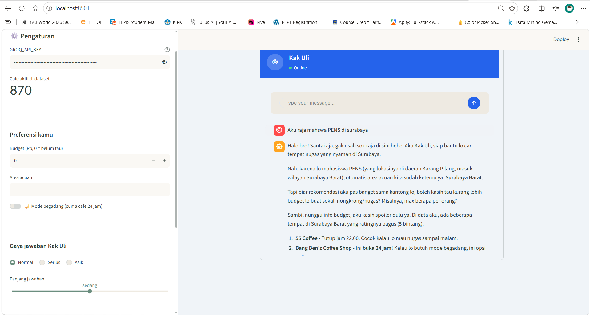
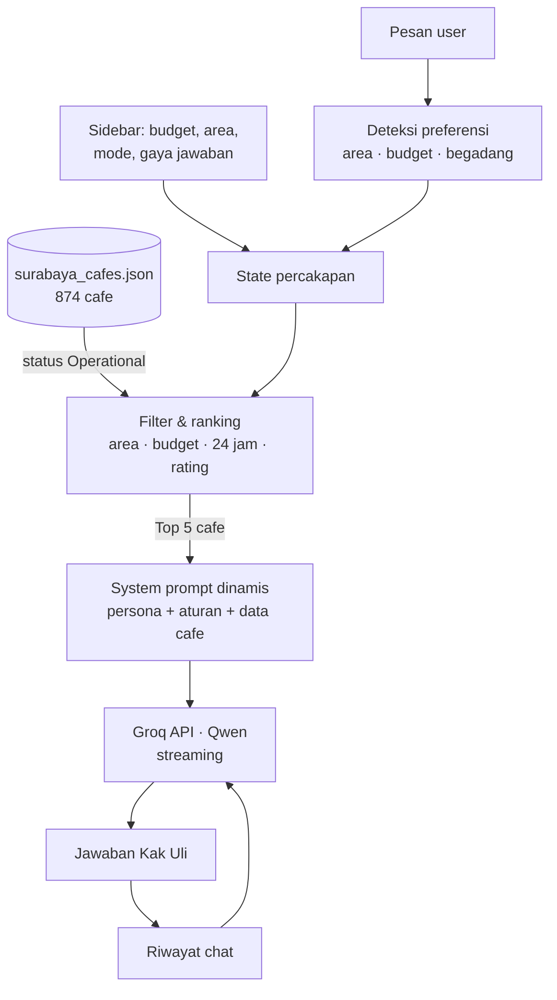
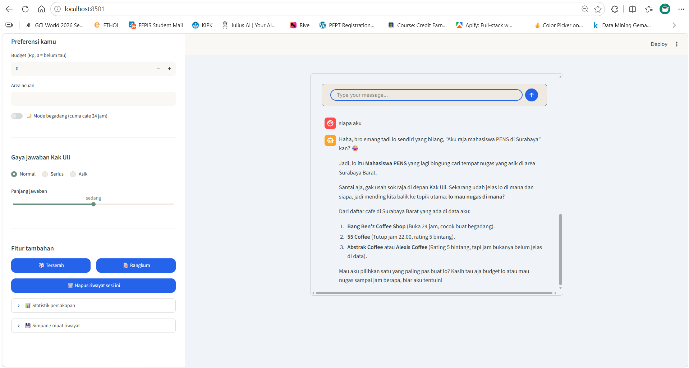
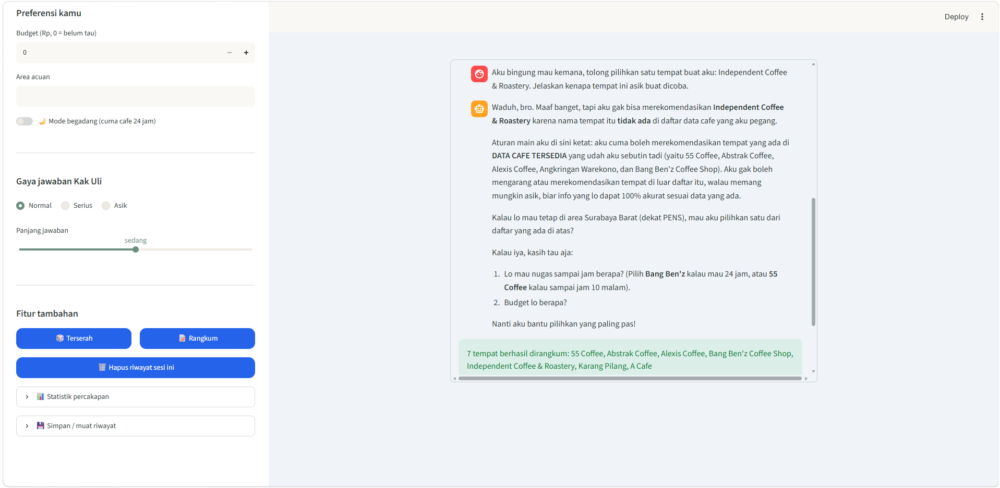
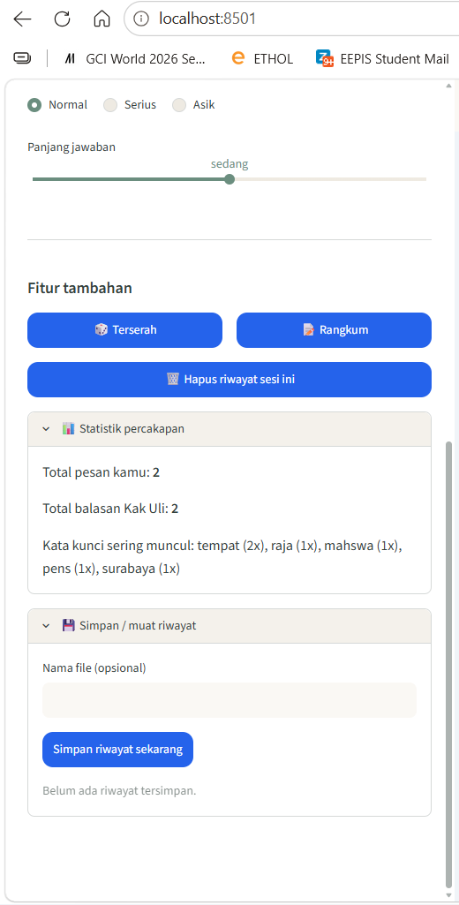

# Kak Uli — Chatbot Cari Cafe Nugas di Surabaya

[](https://www.python.org/)
[](https://streamlit.io/)
[-orange.svg)](https://groq.com/)
[]()

**Kak Uli** adalah chatbot berpersona senior kampus yang santai, membantu mahasiswa menemukan cafe yang *nugas-able* di Surabaya — wifi kencang, ada colokan, nyaman untuk lama-lama, dan ramah di kantong.

Berbeda dari chatbot LLM biasa, setiap jawaban Kak Uli **dibatasi pada dataset cafe asli** yang disuntikkan ke prompt, sehingga ia tidak mengarang nama tempat.



---

## Masalah yang Diselesaikan

Mencari tempat nugas biasanya berarti membuka GMaps, Instagram, dan grup chat satu per satu untuk mengecek harga, jam buka, dan fasilitas. Chatbot LLM umum bisa membantu, tapi sering **berhalusinasi** — menyebut cafe yang tidak ada atau sudah tutup.

Kak Uli menggabungkan **filter data terstruktur** (area, budget, jam buka) dengan **LLM untuk percakapan natural**, jadi rekomendasinya tetap faktual tapi enak diajak ngobrol.

---

## Fitur Utama

### 1. Jawaban Berbasis Data (Anti-Halusinasi)
* Dataset lokal berisi **874 cafe** di Surabaya; hanya cafe berstatus *Operational* di GMaps (**870 cafe**) yang dipakai.
* Sebelum setiap pesan, dataset difilter sesuai preferensi user, lalu **5 cafe teratas berdasarkan rating** disisipkan ke *system prompt*.
* Prompt melarang model menyebut tempat di luar daftar tersebut; jika tidak ada yang cocok, Kak Uli jujur bilang belum menemukan.
* Setiap rekomendasi menyertakan harga, jam buka, rating GMaps, jumlah ulasan, dan link GMaps (jika tersedia di data).

### 2. Deteksi Preferensi Otomatis dari Chat
User tidak wajib mengisi form — kalimat bebas langsung dipahami:

| Kalimat user | Yang terdeteksi |
| :--- | :--- |
| "aku di **Surabaya Pusat**" | Area = Surabaya Pusat (dicocokkan ke 5 area di dataset) |
| "budget **50rb**" / "**1 jt**" / "budget **75000**" | Budget = Rp 50.000 / Rp 1.000.000 / Rp 75.000 |
| "mau **begadang**" | Mode begadang aktif → hanya cafe **24 jam** (166 cafe) |

Jika filter ketat tidak menghasilkan apa-apa, sistem otomatis mencoba lagi tanpa batas budget agar user tetap mendapat opsi.

### 3. Kontrol Gaya Jawaban
* **Mode Normal / Serius / Asik** → mengatur *temperature* (0.7 / 0.2 / 0.9).
* **Panjang jawaban** pendek / sedang / panjang → mengatur *max tokens* (200 / 600 / 1000).
* Jawaban ditampilkan secara **streaming** token demi token.

### 4. Fitur Tambahan
* 🎲 **Terserah** — pilih satu cafe acak yang tetap mengikuti area, budget, dan mode aktif.
* 📝 **Rangkum** — kumpulkan semua cafe yang disebut sepanjang chat ke `daftar_nongkrong.txt` dan bisa diunduh.
* 📊 **Statistik percakapan** — jumlah pesan, kata kunci paling sering, dan area yang paling sering ditanyakan.
* 💾 **Simpan / muat riwayat** — percakapan disimpan sebagai file JSON dan bisa dilanjutkan kapan saja.

---

## Arsitektur



Logika inti dipisah dari tampilan: `kak_uli_core.py` dipakai bersama oleh aplikasi Streamlit dan notebook versi console, sehingga tidak ada kode yang ditulis dua kali.

---

## Struktur Proyek

```text
kak-uli-bot/
├── .streamlit/
│   └── config.toml              # Tema tampilan Streamlit
├── data/
│   └── surabaya_cafes.json      # Dataset 874 cafe Surabaya
├── notebook/
│   ├── Kak_Uli_Chatbot_Groq.ipynb   # Versi console (eksperimen awal)
│   └── riwayat_chat/            # Contoh riwayat percakapan tersimpan
├── screenshot/                  # Tangkapan layar fitur
├── kak_uli_core.py              # Logika inti: filter data, prompt, streaming, fitur
├── app.py                       # Antarmuka web Streamlit
├── requirements.txt
└── README.md
```

### Skema Dataset (ringkas)

| Kolom | Contoh isi |
| :--- | :--- |
| `name`, `area`, `address` | Nama cafe, salah satu dari 5 area Surabaya, alamat |
| `price_range` | `Rp 25–50 rb` (diparse untuk filter budget; cafe tanpa data harga tetap ikut) |
| `opening_hours` | Jam buka, termasuk penanda `24 jam` |
| `latitude`, `longitude` | Koordinat lokasi |
| `gmaps_status`, `gmaps_rating`, `gmaps_review_count`, `gmaps_url` | Data validasi dari Google Maps |

---

## Cara Menjalankan

### 1. Kloning repositori
```bash
git clone https://github.com/0Raja0-RA/kak-uli-bot.git
cd kak-uli-bot
```

### 2. Buat virtual environment & instal dependensi
```bash
python -m venv .venv
# Windows
.venv\Scripts\activate
# Linux / macOS
source .venv/bin/activate

pip install -r requirements.txt
```

### 3. Siapkan API key Groq
Buat API key gratis di [console.groq.com](https://console.groq.com/), lalu buat file `.env`:
```env
GROQ_API_KEY=isi_api_key_kamu
```
API key juga bisa langsung diisi di sidebar aplikasi. File `.env` sudah masuk `.gitignore`.

### 4. Jalankan aplikasi
```bash
streamlit run app.py
```
Buka **http://localhost:8501** di browser.

---

## Tangkapan Layar

| Ingatan konteks | Rangkum tempat |
| :---: | :---: |
|  |  |
| **Statistik & simpan riwayat** | |
|  | |

---

## Keterbatasan

* Data cafe bersifat statis; harga dan jam buka bisa berubah. Karena itu Kak Uli selalu mengingatkan user untuk mengecek ulang di GMaps atau media sosial.
* Kolom `facilities` dan `needs_tags` di dataset belum terisi, sehingga filter fasilitas (wifi, colokan) belum bisa dipakai; 339 cafe juga belum memiliki data harga.
* Deteksi area hanya mengenali nama area yang ada di dataset (Surabaya Barat, Pusat, Selatan, Timur, Utara).
* Ranking hanya berdasarkan rating GMaps, belum mempertimbangkan jarak dari lokasi user.

## Pengembangan Selanjutnya
* Melengkapi data fasilitas (wifi, colokan) dan harga agar filter "nugas-able" benar-benar berbasis atribut.
* Rekomendasi berdasarkan jarak memakai kolom `latitude` / `longitude`.
* Pencarian semantik (embedding) untuk permintaan seperti "yang tenang" atau "ada outdoor".
* Deploy ke Streamlit Community Cloud.
